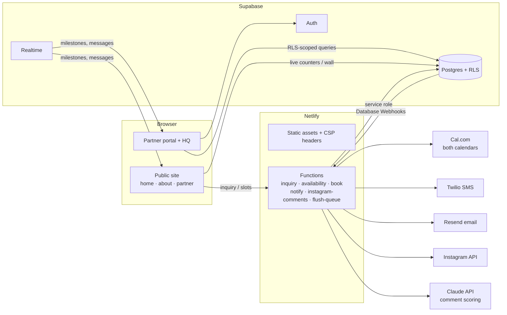

# Ellis Adventures — partner site & portal (concept prototype)

A clickable prototype of a business-forward website for **Kelsey & Zach** (`@thekelseyellis.adventure`, `@zellis88`, TikTok `@ellis.adventures`), the NY-based bucket-list travel creators. It's a worked example of this playbook's stack: a static front end, Netlify Functions and Supabase with row-level security.

> **Status: concept prototype.** The front end runs entirely in the browser on sample data, so anyone can click through every flow with no accounts or keys. The production backend (functions + schema) is written, type-checked and RLS-tested, but **not yet wired to the UI** (see [Path to launch](#path-to-launch)).

## Run it

```bash
cd examples/ellis-adventures-partner-site
python3 -m http.server 8888     # or: npm run dev
# open http://localhost:8888
```

Opening `index.html` directly from disk also works. Data lives in `localStorage`. **Reset demo** in the top banner restores the sample data.

| Try this | Where |
|---|---|
| New brand inquiry → book a discovery call → see the texts/emails that fire | **Start a partnership** (header or hero) |
| Turn that inquiry into a portal account (it links automatically) | Last step of the inquiry → **Create your partner portal account** |
| Existing partner view | Partner Portal → **Explore as a partner** (Maya · Sunline Resorts, a sample brand) |
| Kelsey & Zach's HQ view | Partner Portal → **View as Kelsey & Zach** |
| Watch the live counter tick | In HQ, open a collaboration and **Mark complete**, then go back to the home page (it also syncs across browser tabs) |

## What's real and what's sample

| From Kelsey & Zach's public Linktree (real) | Illustrative sample data |
|---|---|
| Bio, NY location, handles, contact email | Partner companies (Sunline, Driftwood, Tidepool, Aurora are fictional) |
| Palette `#d8cfc0 / #e8e0d2 / #2d2f2a / #b49b6e`, Playfair Display + Inter | Counter totals, audience-snapshot percentages |
| Positano Fiat 500 and Moorea shark photos (hot-linked from their Linktree CDN) | Every Instagram comment on the audience wall (masked handles) |
| Gear and affiliate brands (Insta360, DJI, DIVEVOLK, Hat Harness, MAKE Wellness, Factor, Modere, LTK) and codes | Upcoming trips, Innovation Center ideas, proposals, messages |
| Moorea travel guide link | About-page narrative: draft copy for Kelsey & Zach to personalize |

Their Instagram profiles weren't readable without a login, so follower counts and real comments are deliberately **not** fabricated. They come from the Instagram API at launch.

## Requirement → feature map

| Request | Prototype | Production path |
|---|---|---|
| Partnership portal registration (new + existing) | Portal sign-in / **New partner registration**; registering with an inquiry email links the inquiry and its call | Supabase Auth (magic link / Google) + `profiles` / `partners`; new partners start `pending` until HQ verifies |
| Manage project collaborations | **Collaborations** board (Brief → Contracted → In production → Content review → Live → Complete), deliverables, activity, partner **Approve content** | `projects`, `deliverables`, `project_activity`; partners approve via the `approve_content()` RPC only |
| Secure direct communication with Zach & Kelsey | **Messages**: address Kelsey, Zach or both; HQ replies "as" Kelsey or Zach | `threads` / `messages` with RLS per partner; private Storage bucket for attachments; Realtime |
| Proposal management | **Proposals**: send, request changes, revise and resubmit, accept/decline, version history; accepting creates a collaboration | `proposals`, `proposal_versions`, `decide_proposal()` RPC (recipient-only, state-checked) |
| Innovation Center ("influence" campaigns, themes, mutual growth) | Idea board with votes, comments, niche filters, audience-fit score; **Pitch an idea** with a mutual-growth estimator; open trip windows with **Request a slot** | `ideas`, `idea_votes`, `idea_comments`, `collab_windows`; trending ideas notify HQ |
| Brand tone, personal narrative, About Zach & Kelsey tab | Linktree palette and fonts; **About Zach & Kelsey** page: story chapters, who-does-what, beliefs, gear bag, places, signed note | Copy needs Kelsey & Zach's own words |
| New partnership inquiry | 4-step wizard: brand → collaboration → **book a call** → review | `netlify/functions/inquiry.ts` (validation, honeypot, required Turnstile, per-email / per-IP / global rate limits) |
| Calendar booking for new **and** existing partners, same feature | One booking component (`assets/booking.js`): discovery call in the wizard; check-in / content review / strategy session in the portal. Pick Kelsey, Zach or both; travel days are blocked; `.ics` + Google Calendar | Cal.com collective event types (`availability.ts`, `book.ts`) synced to both Google Calendars |
| Automated texts and/or emails to Zach & Kelsey | Every action fires the rules in HQ → **Automations**: per-event channels, recipients, quiet hours, test sends, phone preview, delivery log | Supabase Database Webhooks → `notify.ts` → Twilio (SMS) + Resend (email); `flush-queue.ts` sends texts held during quiet hours |
| Live counter of partnerships, adventures, experiences | Home **The adventure so far** strip, derived from records; ticks when a project completes and from a live feed | `live_counters` view + `milestones` table (written by trigger, no partner data) on Supabase Realtime |
| "See What Our Audience Is Saying" scrolling Instagram-comment screenshots | Two-row marquee of comment "screenshot" cards; HQ → **Audience reviews** to sync, approve, hide, set threshold and mask handles | `instagram-comments.ts` (hourly): Instagram API → Claude scores sentiment, brand-safety and "is it a testimonial" → HQ approval queue → `audience_wall` view (approved only, handles masked server-side) |

Comments render as screenshot-style HTML cards built from the API data, not image captures. That keeps them sharp, accessible and quick to remove if a commenter asks.

## Architecture



### Texts and emails

| Event | Default channels → who |
|---|---|
| New partnership inquiry | Text + email → Kelsey, Zach; email → shared inbox; email confirmation → brand (never a text: the number is unverified) |
| Call booked | Text + email → whoever was booked (Kelsey, Zach or both); confirmation → partner |
| New direct message | Text + email → only the creator it was addressed to |
| Proposal submitted / sent / decided | Text + email → K&Z; email (+ opt-in text) → partner |
| New partner account / partner invited | Text + email → K&Z / invite email → partner |
| Collaboration stage change | Email → K&Z + partner |
| Innovation idea trending (20 votes) | Email → K&Z |
| Comments ready to approve | Daily-style digest email → Kelsey |

Quiet hours (10pm–7am ET by default) hold texts until morning. Email always sends.

## Security model

- **Row-level security on every table**, enabled in the same migration that creates it (playbook rule). Partners see only their own company's rows. The Innovation Center board is shared on purpose, but only with verified partners.
- **State changes go through guarded functions** (`approve_content`, `decide_proposal`), so a partner can't edit stages, budgets or statuses directly.
- **No messaging, scheduling, Instagram or Claude credential ever reaches the browser.** All of them live in Netlify Functions, and the webhook endpoint checks a shared secret with a timing-safe compare.
- **Public data is narrow**: `live_counters`, `milestones` and the `audience_wall` view. The view returns only approved comments and masks handles in the database, not in the browser.
- **Instagram comments are untrusted input.** The scoring prompt treats them as data only, the output is schema-constrained JSON, and nothing appears publicly without a human approval.

The migration was applied to Postgres 16 with stubbed Supabase `auth` objects and passed a behavioral RLS suite: partner isolation, blocked self-approval, the RPC paths, the counter trigger, and anonymous access limited to approved and masked data.

## Path to launch

1. **Kelsey & Zach review**: replace draft About copy with their own words; supply licensed photos (the prototype hot-links their Linktree images); confirm partner formats and the gear list.
2. **Accounts**: Supabase project (run `supabase/migrations/001_partner_platform.sql`), Netlify site, Twilio Messaging Service with **A2P 10DLC registration** (required for US business texting; allow ~1–2 weeks), Resend domain, Cal.com with both Google Calendars and collective event types, Meta app with Instagram API access for both professional accounts, Anthropic API key.
3. **Wire the front end**: swap `assets/store.js` reads and writes for Supabase queries (the shapes match), point the booking component at `availability` / `book`, and post the inquiry wizard to `inquiry`. Fill in `.env.example` values as Netlify environment variables, then set up the Database Webhooks listed at the bottom of the migration.
4. **Testimonial consent**: keep handle masking on, add a "request removal" link, and consider auto-replying to a comment to ask permission before featuring it.
5. Run the playbook's `templates/production-readiness-checklist.md` and `templates/security-checklist.md`.

## Files

```text
index.html                 page shell (header, footer, demo banner)
assets/styles.css          brand tokens + all components
assets/ui.js               helpers: time zones, icons, modal, toast, .ics
assets/data.js             real brand facts + sample seed data (relative dates)
assets/store.js            localStorage store, same shape as the schema; RLS twin
assets/notify.js           client mirror of the automation rules (demo)
assets/booking.js          the shared booking calendar
assets/site.js             home, About Zach & Kelsey, Partner With Us, inquiry wizard
assets/portal.js           partner portal + Kelsey & Zach HQ
assets/app.js              router + boot
netlify/functions/*.ts     inquiry, availability, book, notify, instagram-comments, flush-queue
netlify/lib/*.ts           Supabase admin client, Twilio/Resend delivery, Cal.com
supabase/migrations/       schema, RLS, RPCs, views, seed rules
```

`npm install && npm run typecheck` type-checks the functions.
